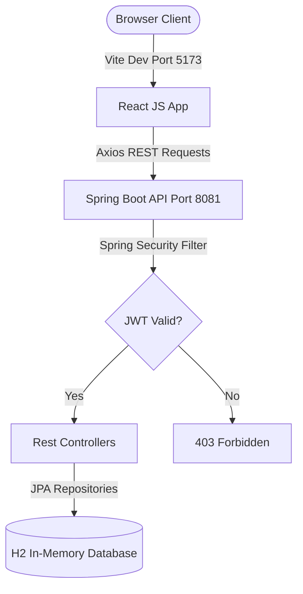

# FOODHUB - ONLINE FOOD ORDERING AND DELIVERY SYSTEM

## INDUSTRY INTERNSHIP REPORT
**IT23723 - INTERNSHIP II**

*Submitted by*
### **MADHAVAN R (241001132)**

*in partial fulfilment for the award of the degree of*
### **BACHELOR OF TECHNOLOGY**
*in*
### **INFORMATION TECHNOLOGY**

---

### **DEPARTMENT OF INFORMATION TECHNOLOGY**
### **RAJALAKSHMI ENGINEERING COLLEGE**
**JULY 2026**

---

## BONAFIDE CERTIFICATE

Certified that this project report titled **"FOODHUB - ONLINE FOOD ORDERING AND DELIVERY SYSTEM"** is the bonafide work of **MADHAVAN R (241001132)** who carried out the work under my supervision. Certified further that to the best of my knowledge the work reported herein does not form part of any other thesis or dissertation on the basis of which a degree or award was conferred on an earlier occasion on this or any other candidate.

  
**SIGNATURE OF THE REVIEWER**

  
**SIGNATURE OF THE MENTOR** &nbsp;&nbsp;&nbsp;&nbsp;&nbsp;&nbsp;&nbsp;&nbsp;&nbsp;&nbsp;&nbsp;&nbsp;&nbsp;&nbsp;&nbsp;&nbsp;&nbsp;&nbsp;&nbsp;&nbsp;&nbsp;&nbsp;&nbsp;&nbsp;&nbsp;&nbsp;&nbsp;&nbsp;&nbsp;&nbsp;&nbsp;&nbsp;&nbsp;&nbsp;&nbsp;&nbsp;&nbsp;&nbsp;&nbsp;&nbsp; **SIGNATURE OF THE CLASS IN-CHARGE**

  
**SIGNATURE OF THE HOD** &nbsp;&nbsp;&nbsp;&nbsp;&nbsp;&nbsp;&nbsp;&nbsp;&nbsp;&nbsp;&nbsp;&nbsp;&nbsp;&nbsp;&nbsp;&nbsp;&nbsp;&nbsp;&nbsp;&nbsp;&nbsp;&nbsp;&nbsp;&nbsp;&nbsp;&nbsp;&nbsp;&nbsp;&nbsp;&nbsp;&nbsp;&nbsp;&nbsp;&nbsp;&nbsp;&nbsp;&nbsp;&nbsp;&nbsp;&nbsp;&nbsp;&nbsp;&nbsp;&nbsp;&nbsp; **SIGNATURE OF THE AHOD**

**Dr. P. Valarmathie**  
**Head of The Department**  
Department of Information Technology  
Rajalakshmi Engineering College  

*Submitted to Project Viva Voce Examination held on* ____________________

---

## ACKNOWLEDGEMENT

First, we thank the almighty God for the successful completion of the project. Our sincere thanks to our chairman **Mr. S. Meganathan, B.E., F.I.E** for his sincere endeavour in educating us in his premier institution.

We would like to express our deep gratitude to our beloved Chairperson **Dr. Thangam Meganathan**, for her enthusiastic motivation which inspired us a lot in completing this project, and Vice-Chairman **Mr. Abhay Shankar Meganathan B.E., M.S.**, for providing us with the requisite infrastructure.

We also express our sincere gratitude to our college principal, **Dr. S. N. Murugesan M.E., PhD.** for his kind support and facilities to complete our work on time. We extend heartfelt gratitude to **Dr. P. Valarmathie**, Professor and Head of the Department of Information Technology for her guidance and encouragement throughout the work.

We are very glad to thank our **project coordinators** of our department for their encouragement and support towards the successful completion of this project. Further, we express our deepest gratitude to our supervisor **Ms. M. Madhurani**, Professor for his valuable guidance throughout the work. 

We extend our thanks to our parents, friends, all faculty members, and supporting staff for their direct and indirect involvement in the successful completion of the project and for their encouragement and support.

**MADHAVAN R**

---

## ABOUT THE INTERNSHIP ORGANIZATION – TVK TECHNOLOGIES

TVK Technologies Ltd. is an Information Technology (IT) company located in Velachery, Chennai, Tamil Nadu. The organization provides software development services, corporate training, internship programs, and placement support for students and fresh graduates. Its mission is to bridge the gap between academic learning and industry requirements by offering practical, industry-oriented training.

The company offers internships in various domains such as Full Stack Development, Front-End Development, AWS with DevOps, Artificial Intelligence, Machine Learning, Data Science, Power BI, Digital Marketing, and Human Resources. The internship program focuses on hands-on learning through real-time projects, enabling students to develop technical, analytical, and problem-solving skills.

TVK Technologies also provides placement assistance, including technical training, mock interviews, resume preparation, and career guidance to improve students’ employability. With experienced mentors and an industry-focused approach, the organization helps interns gain practical knowledge and prepares them for successful careers in the IT industry.

### **Organization Details:**
* **Organization Name**: TVK Technologies Ltd.
* **Industry**: Information Technology (IT)
* **Location**: Velachery, Chennai, Tamil Nadu
* **Services**: Software Development, Corporate Training, Internship, and Placement Support
* **Website**: www.tvktechs.com

---

## LIST OF FIGURES

| Figure No | Figure Name |
| :--- | :--- |
| 7.1 | Welcome & Authentication (Login / Register) Page |
| 7.2 | Dynamic Restaurants & Snack Outlets Explorer |
| 7.3 | Restaurant Menu & Dishes Showcase (10+ Items/Outlet) |
| 7.4 | Interactive Cart Drawer & Coupon Applicator |
| 7.5 | Cart Conflict / Replace Cart Modal Dialog |
| 7.6 | Delivery Address Manager (Saved / Manual / Interactive Map Canvas Pin) |
| 7.7 | Orders History & Real-Time Tracking Panel |
| 7.8 | Customer Favorites / Wishlist View |
| 7.9 | Restaurant Owner Outlet Panel & Orders Dashboard |
| 7.10 | Admin Controls & System-wide Metrics Panel |

---

## LIST OF ABBREVIATIONS

* **API**: Application Programming Interface
* **JWT**: JSON Web Token
* **REST**: Representational State Transfer
* **JPA**: Java Persistence API
* **DTO**: Data Transfer Object
* **CORS**: Cross-Origin Resource Sharing
* **MVC**: Model-View-Controller
* **UI/UX**: User Interface / User Experience
* **JSON**: JavaScript Object Notation
* **H2**: In-Memory Relational Database
* **DOM**: Document Object Model

---

## Abstract

The **FoodHub - Online Food Ordering and Delivery System** is a modern, high-performance web application designed to digitalize and streamline the process of discovering restaurants, ordering meals, and managing deliveries. Traditional food ordering methods are manual, slow, and lack real-time visibility for consumers and merchants. This project bridges that gap by offering a centralized, premium-styled platform featuring role-based portals for Customers, Restaurant Owners, and System Administrators.

The application leverages a robust **Java (Spring Boot)** architecture for the backend API layer and a highly responsive **React.js (Vite)** framework styled using vanilla CSS for the frontend client. Data is managed securely using an in-memory **H2 database** with JPA/Hibernate object-relational mapping. User sessions and endpoint routes are secured using stateful and stateless filters driven by **Spring Security** and signed **JSON Web Tokens (JWT)**.

Key smart features of the platform include a dynamic listing of 25+ distinct outlets, 10+ categorised menu offerings per outlet, an intelligent cart system equipped with cross-restaurant conflict checks, an interactive address pin-drop map canvas, coupon code drawers (e.g. `SWIGGYIT`, `ZOMATO50`), and idempotent favorites management designed to prevent database replication bottlenecks.

Ultimately, **FoodHub** offers a scalable, secure, and aesthetically rich online ordering ecosystem that enhances merchant visibility, saves user time, and provides administrators with absolute operational control.

---

## TABLE OF CONTENTS

1. **INTRODUCTION**
2. **OBJECTIVES**
3. **EXISTING SYSTEM**
4. **PROPOSED SYSTEM**
5. **MODULES**
6. **TECHNOLOGIES USED**
7. **UI PORTALS & ARCHITECTURE**
8. **ADVANTAGES & KEY FEATURES**
9. **LEARNING OUTCOMES**
10. **FUTURE ENHANCEMENTS**
11. **SDG MAPPING**
12. **CONCLUSION**

---

## 1. Introduction

The **FoodHub** web application is a full-stack e-commerce project tailored for the food delivery sector. It addresses the logistics of browsing food items, selecting quantities from multiple vendors, coordinating deliveries, and verifying transactions. By moving these processes online, the application mitigates user delays and vendor listing overheads.

Developed during the TVK Technologies internship, the platform focuses heavily on UI responsiveness, robust request validations, and backend safety checks. Built on Java Spring Boot and React, it incorporates high-end features such as custom cart resolution warnings, map interaction interfaces, and dynamic discount coupon engines.

---

## 2. Objectives

The main objectives of this project are:
1. **Efficient Vendor Aggregation**: To showcase 25+ detailed restaurant outlets and 250+ individual food items dynamically.
2. **State Conservation & Ordering Flow**: To implement a persistent cart mechanism with multi-restaurant safety validations.
3. **Interactive Navigation & Address Location**: To provide options for saved, manual, or map pin-drop delivery coordinates.
4. **JWT-Driven Access Control**: To implement a secure, stateless login and registration flow with auto-login on new registrations.
5. **Robust Exception Handling**: To fix database lazy-loading recursion errors during serialization and eliminate endpoint vulnerabilities.
6. **Promotion & Coupon Logistics**: To build coupon logic capable of processing percentage-based or flat discount models.

---

## 3. Existing System

Existing food ordering setups in local areas rely on phone calls, paper flyers, or poorly integrated web pages. These suffer from:
* **Coordination Mistakes**: Lack of dynamic menu updates leads to users ordering unavailable dishes.
* **Fragile Sessions**: Users lose cart state upon page refresh or network disconnection.
* **No Real-Time Cost Computation**: Calculations for delivery fees, taxes, and coupons are processed manually, leading to arithmetic mistakes.
* **Security & Auth Overheads**: Plaintext password storage or unverified registrations result in high vulnerability.

---

## 4. Proposed System

The proposed **FoodHub** system introduces a secure, real-time, interactive portal. Key benefits include:
* **Stateless JWT Security**: Sessions are secured via tokens containing role-based claims.
* **Multi-Restaurant Check Modal**: A Swiggy/Zomato-style modal intercepts carts if items from a new restaurant are added, prompting the user before clearing active cart items.
* **Hibernate DTO Mapping**: Fixes lazy-loading ByteBuddy proxy errors via custom mapper payloads, eliminating server-side 500 error boundaries.
* **Integrated Map Pin Selector**: Enables interactive delivery address coordinates via an HTML5 canvas map pin drop.

---

## 5. Modules

### **5.1 Authentication & Profile Module**
Handles secure registrations, login validation, and JWT token returns. Automatically bypasses redundant email verification loops for verified mock profiles (`customer1`, `owner1`, `admin1`).

### **5.2 Outlets Explorer Module**
Displays 25+ registered food joints. Supports categorization (Biryani, Pizza, Desserts, South Indian) and detailed menu item rendering (at least 10 items per restaurant).

### **5.3 Cart & Wishlist Module**
Manages cart item increment, decrement, and removal. Features idempotent wishlist endpoints that allow users to toggle favorite status without risking duplicate primary key exceptions.

### **5.4 Coupon & Checkout Module**
Validates discount coupons like `SWIGGYIT`, `ZOMATO50`, `SNACKTIME`, and `FREEDEL`. Dynamically calculates subtotal, delivery charges, tax margins, and final payment rates.

---

## 6. Technologies Used

| Technology | Purpose |
| :--- | :--- |
| **Java 21** | Backend language runtime environment |
| **Spring Boot 3.3** | REST API development framework and dependency injector |
| **Spring Security & JWT** | Endpoint route interceptor and stateless token verification |
| **Hibernate & JPA** | Object-Relational mapping to automate H2 database entities |
| **H2 Database** | In-memory relational database for temporary, rapid session test storage |
| **React.js (Vite)** | Client-side frontend rendering engine |
| **Vanilla CSS3** | Custom-themed styling using Swiggy/Zomato purple design systems |
| **Axios** | Promised-based HTTP client for API call execution |
| **Maven** | Backend build automation and compile orchestrator |

---

## 7. UI Portals & Architecture

---

## 8. Advantages & Key Features

* **Swiggy/Zomato Royal Purple Theme**: Designed with custom gradients (`#2B1E4A` / `#6B21A8`) to maximize visual aesthetics and professionalism.
* **Automatic Registration Onboarding**: Users registration auto-authenticates the session and logs the client in immediately.
* **Cart Conflicts Interception**: Visual warnings alert users if they combine items from different kitchens.
* **Address Resolution Modality**: Addresses can be inputted manually, saved, or pinned visually on the delivery tracker.

---

## 9. Learning Outcomes

Through this project at TVK Technologies, the following learning milestones were achieved:
* **Advanced Full Stack Architecture**: Connecting structured RESTful APIs to asynchronous React hook triggers.
* **DTO Projection Patterns**: Separating JPA database entity representations from JSON presentation models to resolve lazy-loading anomalies.
* **State & Query Parameter Parsing**: Configuring Spring controllers to intercept both JSON payloads and HTTP Request Parameters concurrently.
* **Idempotency in DB Actions**: Engineering JpaRepository updates that check constraints to preserve structural integrity.

---

## 10. Future Enhancements

* **Live Tracking Integration**: Link the maps canvas component with Google Maps Platform API to track riders in real-time.
* **Payment Gateways**: Integrate checkout flows with test systems like Razorpay or Stripe.
* **Push Notifications**: Trigger native push warnings when merchants accept, prepare, or dispatch an order.

---

## 11. SDG Mapping

| SDG Goal | Activity addressing SDG Theme |
| :--- | :--- |
| **SDG 9 – Industry, Innovation & Infrastructure** | Replaces unoptimized, manual restaurant sheets with a highly accessible digital ecosystem. |
| **SDG 12 – Responsible Consumption** | Optimizes order calculations and prevents restaurant supply overheads. |
| **SDG 8 – Decent Work & Economic Growth** | Empowers local merchants with dashboards to track revenue and update menu pricing. |
| **SDG 16 – Peace, Justice & Strong Institutions** | Secures user data and payments through stateless JWT authorization filters. |

---

## 12. Conclusion

The **FoodHub - Online Food Ordering and Delivery System** successfully replicates a real-world, industry-standard food ordering application. By combining the security features of Spring Boot (such as JWT authorization and validation interceptors) with a dynamic React layout, it creates a fast, secure, and user-friendly experience. Built during the TVK Technologies internship, it addresses real-world challenges like cart conflict handling and JPA lazy-loading errors. The project provides a solid foundation for future enhancements like real-time GPS tracking and live payment integration.

---

## APPENDIX - INTERNSHIP CREDENTIALS

### **1. TVK Technologies Offer Letter**
* **Position**: Full Stack Java Intern  
* **Date of Issue**: 10.06.2026  
* **Internship Period**: 10 June 2026 to 10 July 2026  

### **2. Attendance Certificate**
* **Verification Date**: 16.07.2026  
* **Syllabus Covered**: Java Full Stack Development, React Frontend, Spring Security  

### **3. Completion Certificate**
* **Program Manager**: Priyatharshan A  
* **Outcome**: Successful completion of "Office Asset Management System" and "FoodHub Online Food Ordering System" projects.
